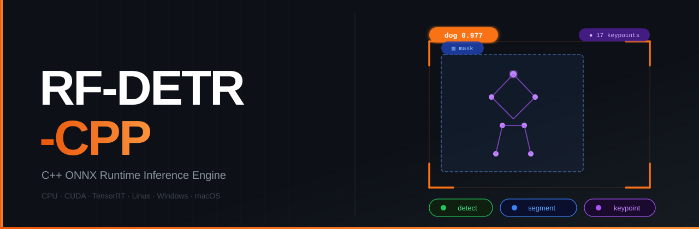
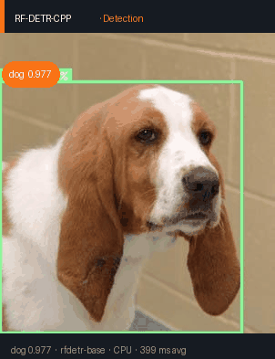

<div align="center">
  
</div>

<br/>

<div align="center">

[](https://github.com/Geekgineer/RF-DETR-CPP/stargazers)
[](https://github.com/Geekgineer/RF-DETR-CPP/actions/workflows/ci.yml)
[](LICENSE)
[](https://en.cppreference.com/w/cpp/17)
[](https://github.com/microsoft/onnxruntime/releases/tag/v1.20.1)
[](https://github.com/Geekgineer/RF-DETR-CPP)

</div>

<div align="center">

**[Installation](#quickstart) · [C++ API](#c-api) · [Supported Models](#supported-models) · [Benchmarks](#benchmarks) · [Tests & CI](#tests--ci) · [Docker](#docker) · [Contributing](#license)**

</div>

---

## What is RF-DETR-CPP?

**RF-DETR-CPP** is a header-only C++ inference library for [RF-DETR](https://github.com/roboflow/rf-detr) — Roboflow's real-time, transformer-based object detector that achieves state-of-the-art COCO accuracy with DINOv2 Vision Transformer features and DETR-style set-prediction.

One `#include` gives you a production-ready pipeline for all three RF-DETR task families:

| Task | Header | Class |
|---|---|---|
| **Detection** | `rfdetrs/tasks/detection.hpp` | `rfdetrs::det::RFDETRDetector` |
| **Segmentation** | `rfdetrs/tasks/segmentation.hpp` | `rfdetrs::seg::RFDETRSegDetector` |
| **Keypoint** | `rfdetrs/tasks/keypoint.hpp` | `rfdetrs::kp::RFDETRKeypointDetector` |

CPU, CUDA, and TensorRT execution providers are selected at construction time with a single `BackendType` enum. The library requires **zero runtime Python** — export your model once, deploy anywhere.

---

## Latest News

- **[2026-06-25]** Full CI/CD pipeline shipped: detection parity, segmentation structural, and keypoint structural test suites all green on every push to `main`.
- **[2026-06-25]** Segmentation (`RFDETRSegDetector`) and Keypoint (`RFDETRKeypointDetector`) tasks added with per-task CLIs, GTest suites, and reference scripts.
- **[2026-06-24]** Initial release — RF-DETR detection for all 5 Apache-2.0 variants (Nano · Small · Base · Medium · Large) with parity-verified C++/Python pipeline.

---

## Demo

<div align="center">
  
  <br/>
  <sub>Real street scene — Detection (rfdetr-base) · Segmentation (rfdetr-seg-nano) · Keypoint (rfdetr-keypoint-preview, 17 COCO kp) · CPU inference</sub>
</div>

---

## Why RF-DETR-CPP?

| Challenge | Solution |
|---|---|
| Python runtime dependency at inference time | Export ONNX once; C++ requires zero Python |
| NMS tuning for transformer detectors | RF-DETR uses flat top-K — no NMS, no anchor grid |
| Provider lock-in | `BackendType::CPU/CUDA/TensorRT` with automatic fallback |
| Multi-task model variants | Single API surface for detection, segmentation, and keypoint |
| Letterbox vs stretch confusion | Stretch resize + ImageNet normalisation matches RF-DETR exactly |
| CI gap: Python passes, C++ diverges | Tight-tolerance parity GTests run on every push |

---

## Quickstart

### 1 — Export the ONNX model

```bash
# create virtualenv and install rfdetr
uv venv .venv && uv pip install "rfdetr[onnx]"

# detection  (nano / small / base / medium / large)
.venv/bin/python scripts/export_rfdetr_onnx.py --variant base --out-dir models/

# segmentation
.venv/bin/python -c "
from rfdetr import RFDETRSegNano
m = RFDETRSegNano(); m.export(output_dir='models/', opset=16)
"

# keypoint
.venv/bin/python -c "
from rfdetr import RFDETRKeypointPreview
m = RFDETRKeypointPreview(); m.export(output_dir='models/', opset=16)
"
```

### 2 — Build

```bash
# one-shot build (downloads ORT 1.20.1 automatically if absent)
bash build.sh

# manual — CPU
cmake -B build -DCMAKE_BUILD_TYPE=Release \
      -DONNXRUNTIME_DIR=/path/to/onnxruntime
cmake --build build -j$(nproc)

# manual — with tests
cmake -B build -DCMAKE_BUILD_TYPE=Release \
      -DONNXRUNTIME_DIR=/path/to/onnxruntime \
      -DBUILD_TESTS=ON
cmake --build build -j$(nproc)
```

### 3 — Run

```bash
# detection — image
./build/rfdetr_image_inference models/rfdetr-base.onnx data/dog.jpg \
    models/coco.names 0.5 300 cpu

# detection — video
./build/rfdetr_video_inference models/rfdetr-base.onnx data/video.mp4 \
    out.mp4 models/coco.names

# detection — live camera  (press q to quit, s to snapshot)
./build/rfdetr_camera_inference models/rfdetr-base.onnx 0 models/coco.names

# segmentation
./build/rfdetr_seg_image_inference models/rfdetr-seg-nano.onnx data/dog.jpg \
    models/coco.names 0.5

# keypoint
./build/rfdetr_keypoint_image_inference models/rfdetr-keypoint-preview.onnx \
    data/dog.jpg models/coco.names 0.5
```

> `run_image.sh`, `run_video.sh`, `run_camera.sh` are one-liner wrappers around the CLIs.

---

## C++ API

### Detection

```cpp
#include "rfdetrs/rfdetrs.hpp"

using namespace rfdetrs;
using namespace rfdetrs::det;

RFDETRDetector detector(
    "models/rfdetr-base.onnx",
    "models/coco.names",
    BackendType::CPU);      // or CUDA / TensorRT

cv::Mat img = cv::imread("image.jpg");
std::vector<Detection> dets = detector.detect(img, 0.5f, 300);

for (const auto& d : dets) {
    // d.box     → BoundingBox { x, y, width, height }  (pixel coords)
    // d.conf    → sigmoid score [0, 1]
    // d.classId → COCO class index
}

detector.drawDetections(img, dets);
cv::imwrite("out.jpg", img);
```

### Segmentation

```cpp
#include "rfdetrs/tasks/segmentation.hpp"

using namespace rfdetrs::seg;

RFDETRSegDetector segdet(
    "models/rfdetr-seg-nano.onnx",
    "models/coco.names",
    rfdetrs::BackendType::CPU);

cv::Mat img = cv::imread("image.jpg");
std::vector<SegDetection> segs = segdet.detect(img, 0.5f, 300);

for (const auto& s : segs) {
    // s.box     → BoundingBox  (pixel coords)
    // s.conf    → confidence score
    // s.classId → class index
    // s.mask    → cv::Mat binary mask (same spatial size as input)
}

segdet.drawDetections(img, segs);
cv::imwrite("out_seg.jpg", img);
```

### Keypoint

```cpp
#include "rfdetrs/tasks/keypoint.hpp"

using namespace rfdetrs::kp;

RFDETRKeypointDetector kpdet(
    "models/rfdetr-keypoint-preview.onnx",
    "models/coco.names",
    rfdetrs::BackendType::CPU);

cv::Mat img = cv::imread("image.jpg");
std::vector<KeypointDetection> kps = kpdet.detect(img, 0.5f, 300);

for (const auto& k : kps) {
    // k.box       → BoundingBox (pixel coords)
    // k.conf      → confidence score
    // k.classId   → class index (0 = background, 1 = person)
    // k.keypoints → std::vector<Keypoint>  { x, y, visibility }
}

kpdet.drawDetections(img, kps);
cv::imwrite("out_kp.jpg", img);
```

`BackendType` falls back gracefully — `CUDA` falls back to CPU if the CUDA EP is unavailable; `TensorRT` falls back CUDA → CPU.

---

## Supported Models

### Detection  (Apache-2.0)

| Variant | Resolution | Patch | Queries | ONNX input |
|---|---|---|---|---|
| **Nano**   | 384 × 384 | 16 | 300 | `float32[1,3,384,384]` |
| **Small**  | 512 × 512 | 16 | 300 | `float32[1,3,512,512]` |
| **Base**   | 560 × 560 | 14 | 300 | `float32[1,3,560,560]` |
| **Medium** | 576 × 576 | 16 | 300 | `float32[1,3,576,576]` |
| **Large**  | 704 × 704 | 16 | 300 | `float32[1,3,704,704]` |

> XL and 2XL (PML 1.0 licence) are intentionally excluded.

### Segmentation

| Variant | Resolution | Mask output |
|---|---|---|
| **SegNano** | 384 × 384 | `float32[1, N, H/4, W/4]` |
| and more via same API | — | — |

### Keypoint

| Variant | Resolution | Keypoints | Schema |
|---|---|---|---|
| **KeypointPreview** | 384 × 384 | 17 (COCO) | `{0: bg, 1: person(17 kp)}` |

---

## ONNX Contracts

| Task | Output name | Shape | Semantics |
|---|---|---|---|
| Detection | `dets` | `[1, N, 4]` | cxcywh normalised to [0, 1] |
| Detection | `labels` | `[1, N, C]` | raw logits (sigmoid in postprocess) |
| Segmentation | `dets` | `[1, N, 4]` | cxcywh normalised |
| Segmentation | `labels` | `[1, N, C]` | raw logits |
| Segmentation | `masks` | `[1, N, H/4, W/4]` | raw mask logits (sigmoid → upsample) |
| Keypoint | `dets` | `[1, N, 4]` | cxcywh normalised |
| Keypoint | `labels` | `[1, N, C]` | raw logits |
| Keypoint | `keypoints` | `[1, N, C×max_K, 8]` | per-class keypoint embeddings |

Outputs are identified by shape (last dim == 4 → boxes), **not** by name — robust to exporter renames.

---

## Inference Pipeline

```
Image (BGR)
    │
    ▼  stretch resize to [H, W]  (no letterbox)
    │  BGR → RGB, ÷ 255
    │  ImageNet normalise  mean=[0.485,0.456,0.406]  std=[0.229,0.224,0.225]
    │  HWC → CHW, add batch dim
    │
    ▼  ORT Session  (CPU | CUDA | TensorRT)
    │
    ▼  Postprocess
         sigmoid(labels) → flatten [N×C]
         partial_sort top-K  →  (score, query_idx, class_idx)
         cxcywh → xyxy, scale to original pixel coords
         threshold by conf_threshold
         [seg] sigmoid(masks) → upsample → threshold
         [kp]  decode keypoint embeddings → (x, y, vis)
    │
    ▼  vector<Detection | SegDetection | KeypointDetection>
```

**No NMS, no objectness gate, no anchor grid** — RF-DETR's flat top-K is the complete postprocess.

---

## Benchmarks

Measured with `rfdetr_benchmark` — 3 warmup runs, 10 timed runs.  
CPU: Intel Core i7, single process, Release build.

| Model | Backend | Min | Avg | Max | FPS |
|---|---|---|---|---|---|
| rfdetr-base | CPU | 388 ms | 399 ms | 442 ms | 2.51 |

```bash
# build benchmark suite
cmake -B benchmarks/build -S benchmarks \
      -DONNXRUNTIME_DIR=/path/to/onnxruntime -DCMAKE_BUILD_TYPE=Release
cmake --build benchmarks/build -j$(nproc)

# run (10 warmup, 200 timed runs)
./benchmarks/build/rfdetr_benchmark models/rfdetr-base.onnx data/dog.jpg \
    models/coco.names --backend cpu --mode image --warmup 10 --iters 200

# automated sweep across all .onnx in models/
./benchmarks/auto_bench.sh --backend cpu --mode image
```

---

## Tests & CI

The CI pipeline runs three independent test-suite jobs on every push and pull request.

| Job | Test binary | What it checks |
|---|---|---|
| `test-suite / detection` | `compare_results` | C++/Python output parity at ±2 px, ±0.002 conf |
| `test-suite / segmentation` | `test_seg` | Session creation, output shapes, mask decode |
| `test-suite / keypoint` | `test_keypoint` | Session creation, output shapes, keypoint decode |

**Detection parity tolerances:**

| Assertion | Tolerance | Rationale |
|---|---|---|
| Detection count | exact | Same top-K, same threshold |
| Bounding box | ±2 px | `int()` rounding of identical float coords |
| Confidence score | ±0.002 | float32 sigmoid precision |

```bash
# run detection parity tests locally
cd tests
./test_detection.sh        # exports model, builds, runs Python + C++ + GTest

# run segmentation / keypoint structural tests
./test_segmentation.sh
./test_keypoint.sh

# run all suites
./test_all.sh
```

CI status: [](https://github.com/Geekgineer/RF-DETR-CPP/actions/workflows/ci.yml)

---

## Docker

```bash
# GPU image  (nvidia/cuda:12.2.0-devel-ubuntu22.04 base)
docker build -t rfdetrs-cpp .
docker run --gpus all --rm rfdetrs-cpp \
    ./rfdetr_image_inference models/rfdetr-base.onnx data/dog.jpg models/coco.names

# CPU-only image  (ubuntu:22.04 base)
docker build -t rfdetrs-cpp:cpu -f Dockerfile.cpu .
docker run --rm rfdetrs-cpp:cpu \
    ./rfdetr_image_inference models/rfdetr-base.onnx data/dog.jpg models/coco.names
```

---

## Project Layout

```
rf-detr-cpp/
├── include/rfdetrs/
│   ├── rfdetrs.hpp                        master include
│   ├── core/
│   │   ├── types.hpp                      BoundingBox, Detection, SegDetection, KeypointDetection
│   │   ├── preprocessing.hpp              stretch resize + ImageNet normalise → CHW blob
│   │   ├── drawing.hpp                    drawBoundingBox, drawMask, drawSkeleton
│   │   └── utils.hpp                      getClassNames, generateColors, sigmoid, clamp
│   ├── tasks/
│   │   ├── detection.hpp                  OrtSessionBase + RFDETRDetector
│   │   ├── segmentation.hpp               RFDETRSegDetector
│   │   └── keypoint.hpp                   RFDETRKeypointDetector
│   └── tools/
│       └── BoundedThreadSafeQueue.hpp     bounded producer-consumer queue (camera pipeline)
├── src/
│   ├── rfdetr_image_inference.cpp         detection CLI
│   ├── rfdetr_video_inference.cpp         detection video CLI
│   ├── rfdetr_camera_inference.cpp        detection camera CLI
│   ├── rfdetr_batch_inference.cpp         detection batch CLI
│   ├── rfdetr_seg_image_inference.cpp     segmentation CLI
│   └── rfdetr_keypoint_image_inference.cpp keypoint CLI
├── examples/
│   ├── example_image_det.cpp
│   ├── example_video_det.cpp
│   └── example_camera_det.cpp
├── benchmarks/
│   ├── rfdetr_benchmark.cpp
│   ├── auto_bench.sh
│   └── CMakeLists.txt
├── tests/
│   ├── build_test.sh                      downloads ORT + builds project (tests/build/)
│   ├── test_utils.sh                      shared helpers (uv, venv, model export)
│   ├── test_detection.sh                  parity runner (Python + C++ + GTest)
│   ├── test_segmentation.sh               structural runner
│   ├── test_keypoint.sh                   structural runner
│   ├── test_all.sh                        run all three suites
│   ├── detection/
│   │   ├── inference_rfdetr_python.py     ORT-python reference → results_python.json
│   │   ├── inference_rfdetr_cpp.cpp       C++ runner → results_cpp.json
│   │   └── compare_results.cpp            GTest parity (±2 px, ±0.002)
│   ├── segmentation/
│   │   └── test_seg.cpp                   GTest structural tests
│   └── keypoint/
│       └── test_keypoint.cpp              GTest structural tests
├── scripts/
│   └── export_rfdetr_onnx.py             export RF-DETR → ONNX
├── models/                               coco.names  rfdetr-*.onnx
├── data/                                 sample images + detection output
├── docs/                                 MkDocs Material site source
├── .github/workflows/ci.yml
├── Dockerfile  Dockerfile.cpu
├── mkdocs.yml
├── build.sh
└── CMakeLists.txt
```

---

## CMake Options

| Option | Default | Description |
|---|---|---|
| `ONNXRUNTIME_DIR` | — | Path to ORT installation (required unless `build.sh` is used) |
| `BUILD_TESTS` | `OFF` | Build GTest parity + structural suites |
| `BUILD_EXAMPLES` | `OFF` | Build example applications |
| `BUILD_BENCHMARKS` | `OFF` | Build benchmark binary |

---

## License

GNU Affero General Public License v3.0 (AGPL-3.0).  
See [`LICENSE`](LICENSE) for the full text.

RF-DETR detection models (Nano · Small · Base · Medium · Large) are released by Roboflow under **Apache-2.0**. The XL and 2XL variants carry a PML 1.0 licence and are **not included**.

---

## Acknowledgments

- [RF-DETR](https://github.com/roboflow/rf-detr) — Roboflow's real-time transformer detector (DINOv2 + GroupPose)
- [ONNX Runtime](https://github.com/microsoft/onnxruntime) — Cross-platform ML inference
- [OpenCV](https://opencv.org/) — Image I/O and preprocessing
- [YOLOs-CPP](https://github.com/Geekgineer/YOLOs-CPP) — API design and CI patterns
- [GoogleTest](https://github.com/google/googletest) — Parity test framework
- [nlohmann/json](https://github.com/nlohmann/json) — JSON result serialisation

---

<div align="center">

**[⭐ Star this repo](https://github.com/Geekgineer/RF-DETR-CPP/stargazers)** if RF-DETR-CPP saves you time.  
Issues, PRs, and benchmarks from new hardware are very welcome.

</div>
